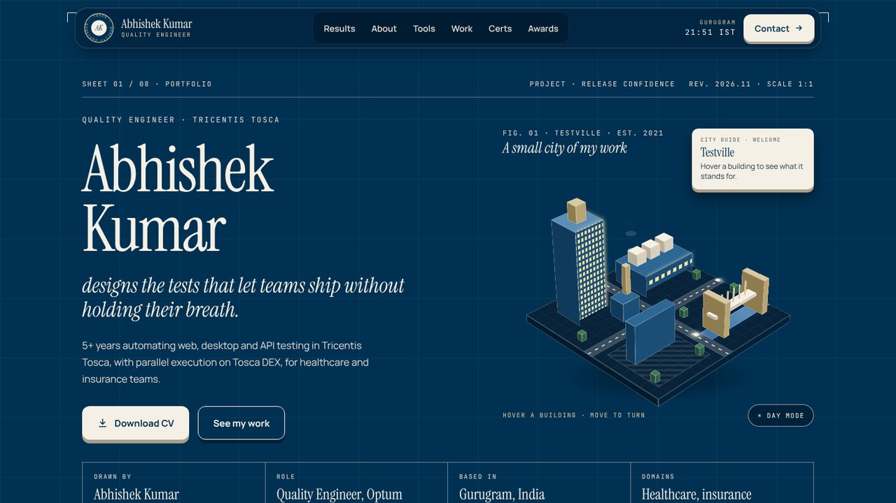
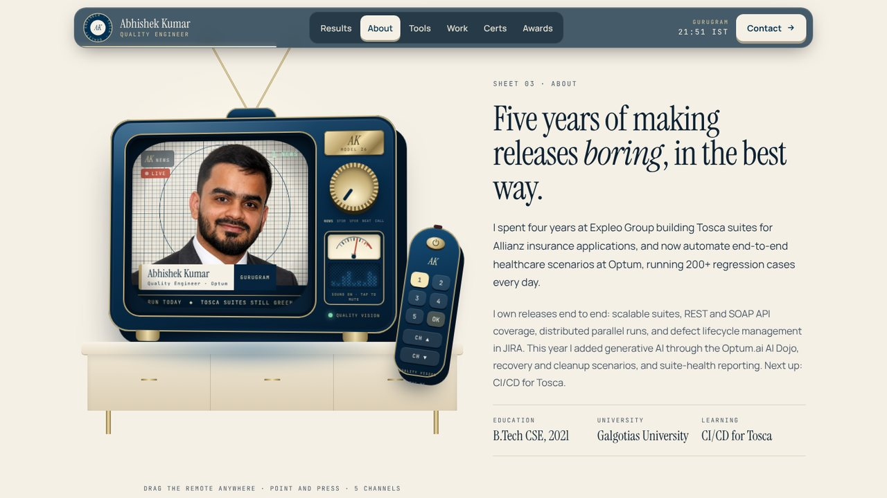
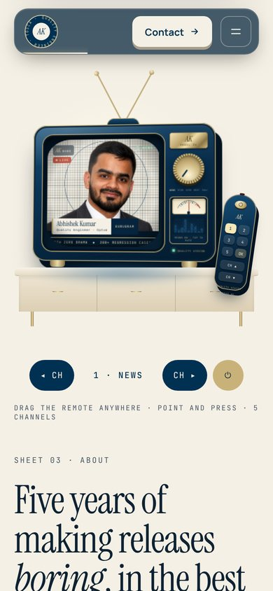
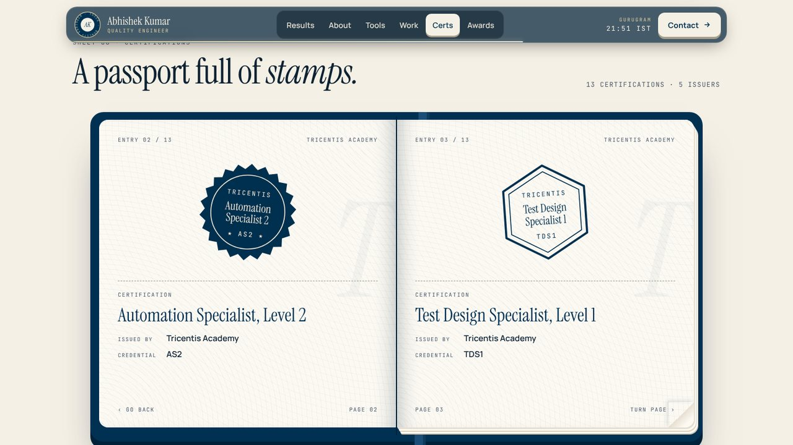

<div align="center">

# Abhishek Kumar · Portfolio

**Quality Engineer · Tricentis Tosca · 5+ years in test automation**

A portfolio drawn like a set of engineering blueprints, where every section is something you can play with.

[**Live site (Vercel)**](https://abhishekkumar-nine.vercel.app/) ·
[**Live site (GitHub Pages)**](https://abhi23raj472.github.io/Abhishek-Kumar/) ·
[**Resume (PDF)**](https://abhi23raj472.github.io/Abhishek-Kumar/Abhishek_Kumar_Resume.pdf) ·
[**LinkedIn**](https://www.linkedin.com/in/abhishek-kumar2301)



</div>

## What's inside

The site is eight "sheets", each with its own interactive piece:

| # | Section | What you can do |
|---|---------|-----------------|
| 01 | **Hero** | Hover the buildings of an isometric mini-city; each one stands for a part of my work. |
| 02 | **Results** | Watch a test report run, with each result passing as it scrolls into view. |
| 03 | **About** | A retro TV with five channels. Drag the remote, point it at the screen and change channels. |
| 04 | **Tools** | Open the drawers of a tool cabinet: automation, API and data, testing, delivery. |
| 05 | **Work** | A career timeline from Expleo to Optum. Pick a role to open its card. |
| 06 | **Certifications** | A passport of 13 certifications. Open it and turn the pages. |
| 07 | **Awards** | A medal wall. Medals swing as you move and flip over on click. |
| 08 | **Contact** | A rotary phone. Dial a hole for email, LinkedIn, CV or location. |

<table>
<tr>
<td width="68%"></td>
<td rowspan="2" width="32%"></td>
</tr>
<tr>
<td></td>
</tr>
</table>

## Built with

- **[Preact](https://preactjs.com/)** + **[htm](https://github.com/developit/htm)**: the page is one component, with no JSX build step.
- **[Vite](https://vite.dev/)**: dev server and production build.
- **Pre-rendering**: the build renders the page to static HTML (`scripts/prerender.mjs`), so it shows instantly and search engines can read it. The browser then makes it interactive.
- **CSS only for the 3D**: transforms, `preserve-3d`, scroll-triggered animations. There's no WebGL or animation library.
- **Fonts**: Instrument Serif, Manrope and JetBrains Mono.

## Quality checks

Built by a tester, so it's checked like a product:

- **Responsive** from 360px phones to large desktops, with no sideways scrolling. Phones get their own layouts, such as stacked passport pages and a large TV channel bar.
- **Touch-friendly**: hover interactions have tap equivalents, and the instructions switch from "hover" to "tap" on touch screens.
- **Accessible basics**: real buttons and links, keyboard focus styles, alt text and ARIA labels. With reduced motion turned on, visitors see the same page without the animation.
- **No broken links**: every in-page anchor, the resume, LinkedIn and email are checked before each release.

## Project structure

```
index.html              page shell, search and social-preview tags
src/
  main.js               entry point (hydrates the pre-rendered page)
  App.js                the whole page as one Preact component
  TvAbout.js, tv.css    About section: the retro TV
  design.css            design styles and responsive rules
  site.css              site-wide rules (smooth scrolling, anchor offsets)
scripts/prerender.mjs   renders the page to HTML at build time
public/                 photo, resume, favicon, social image, sitemap
docs/                   screenshots for this README
```

## Deployment

Every push to `main` deploys to both hosts automatically:

- **GitHub Pages**, through the GitHub Actions workflow in `.github/workflows/deploy.yml`.
- **Vercel**, through its GitHub integration (framework preset Vite, output directory `dist`).

## Contact

- **Email:** [rajputabhishek677@gmail.com](mailto:rajputabhishek677@gmail.com)
- **LinkedIn:** [abhishek-kumar2301](https://www.linkedin.com/in/abhishek-kumar2301)
- **Based in** Gurugram, India

<sub>© 2026 Abhishek Kumar. The design, photo and content are mine; please don't reuse them as your own portfolio.</sub>
